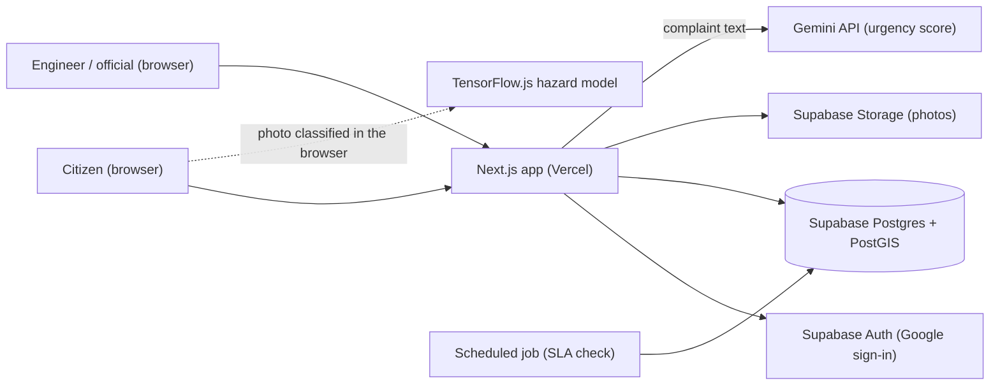
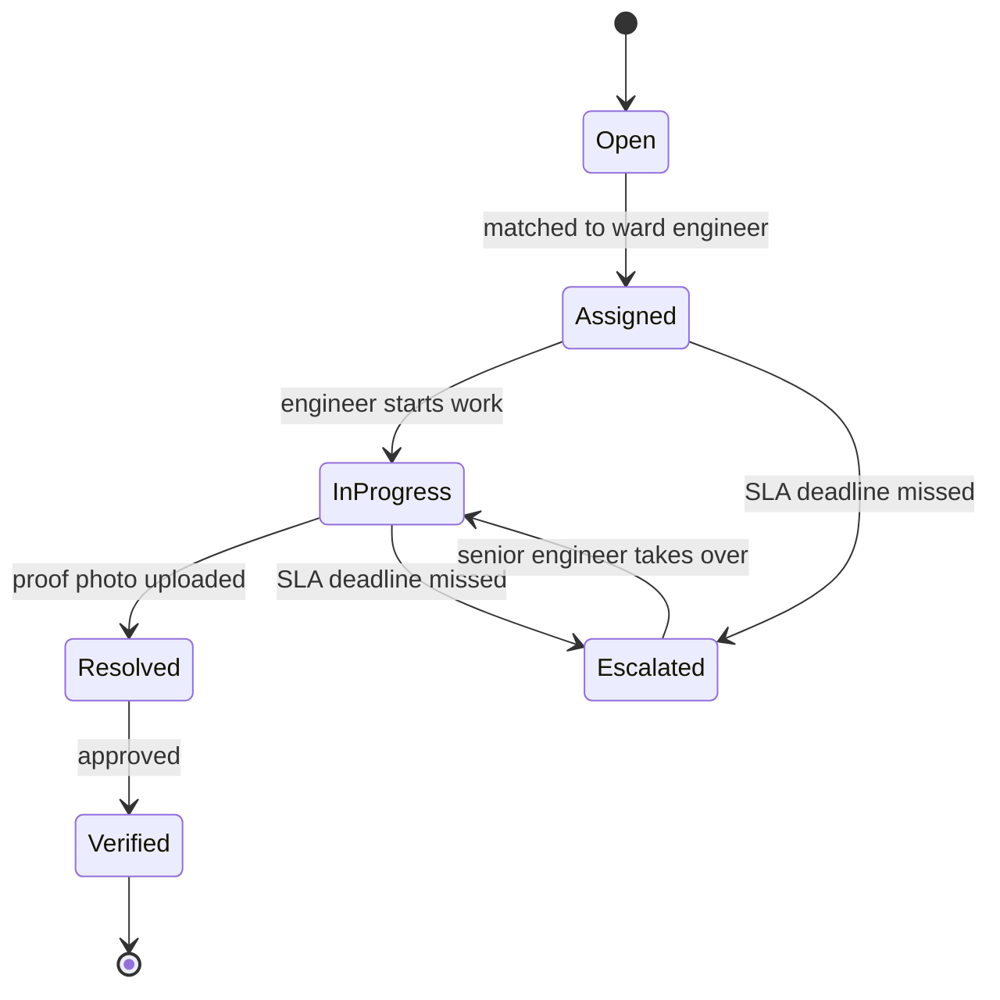

# Architecture

This is the planned design. It will change as we build, and we update this page when it does.

## System overview

## Ticket lifecycle

## Hotspot detection and Location Risk Index

1. Complaints are stored as PostGIS points.
2. DBSCAN clustering groups complaints within a 50 m radius into hotspots.
3. Each hotspot gets a Location Risk Index from complaint frequency, repeat reports after repairs, hazard severity, urgency, and proximity to schools, hospitals and major roads.
4. Officials see hotspots ranked by risk on the map and in a list.

The index formula, its weights and the High / Medium / Low cutoffs will be recorded in the SRS once agreed.

## Good to know

- This project uses Next.js 16. What older versions call Middleware is now called Proxy (`proxy.ts`), which is where session handling for Supabase Auth will go.
- Rules such as SLA escalation and the risk index live in `src/lib/` as plain functions with their inputs as parameters. That keeps them easy to unit test and lets the hotspot feature work before the AI features exist.
