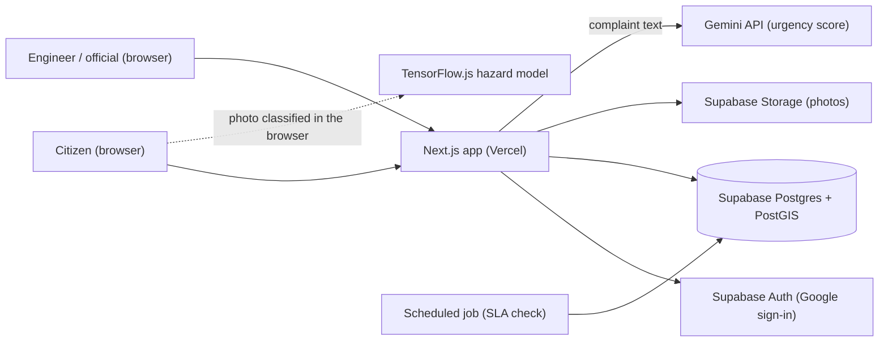
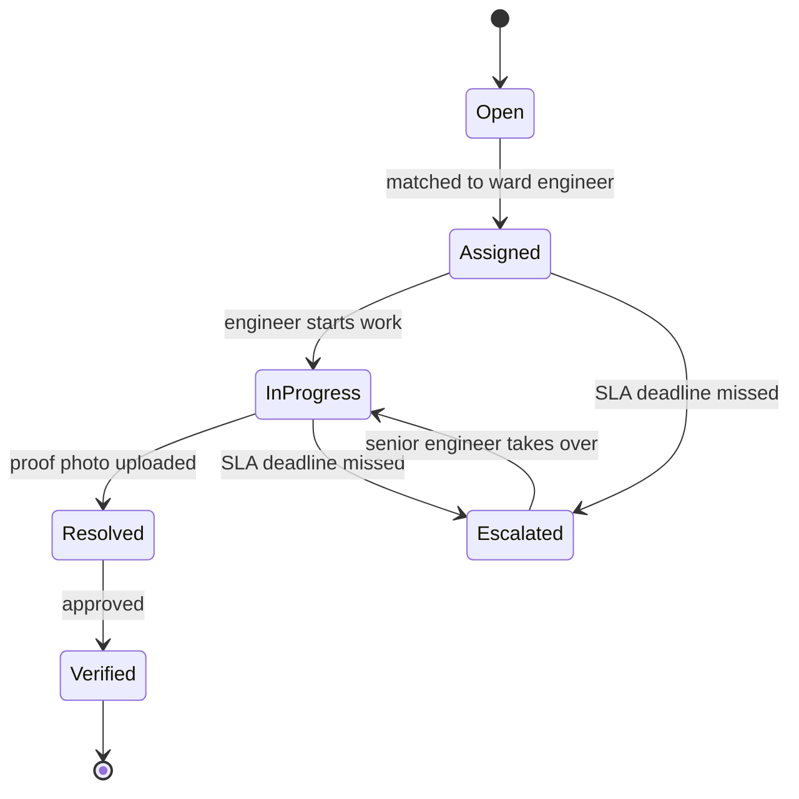

# Architecture

This is the planned design. It will change as we build, and we update this page when it does.

## System overview

## Ticket lifecycle

## Hotspot detection and Location Risk Index

1. Complaints are stored as PostGIS points.
2. DBSCAN clustering groups complaints within a 50 m radius into hotspots.
3. Each hotspot gets a Location Risk Index from complaint frequency, repeat reports after repairs, hazard severity, urgency, and proximity to schools, hospitals and major roads.
4. Officials see hotspots ranked by risk on the map and in a list.

Each factor is scaled to 0 to 1 and combined with these starting weights (see `src/lib/hotspots.ts`):

| Factor | Weight | Scaled as |
|--------|--------|-----------|
| Complaint frequency | 30% | reports in the hotspot divided by 10 |
| Repeat reports after a repair | 20% | repeats divided by 3 |
| Hazard severity | 20% | open manhole 1.0, waterlogging 0.7, pothole 0.6, other 0.3 |
| Proximity to schools, hospitals, major roads | 20% | closeness within 250 m (150 m for roads, counted at 60%) |
| Urgency of the reports | 10% | average urgency divided by 5 |

High is 0.70 or more, Medium is 0.40 to 0.69, Low is under 0.40. The weights are starting values and will be tuned with the team and instructor, then recorded in the SRS.

## Signing in and roles

There are four kinds of people. Each one sees only what their job needs.

| Role | Opens | May do |
|------|-------|--------|
| Resident | Report a problem, My complaints (their own), a complaint they filed | File a complaint, follow it |
| Ward engineer | Dashboard, hotspot map, any complaint | Assign a ticket to themselves, start work, mark it fixed |
| Senior engineer | The same | The same, and take over an escalated ticket |
| Official | The same | Assign a ticket to the ward engineer, and verify a fixed ticket |

In the real system the role is a column in the database. Supabase Auth signs the person in with Google, the Next.js proxy (`proxy.ts`) sends signed-out visitors to the sign-in page, and Row Level Security in Postgres decides which rows each role can read and change. The checks in the browser are only there so people do not see buttons they cannot use.

## How the prototype stands in for the back end

Until the Supabase part is built, the prototype keeps the same shapes of data in the browser (`src/lib/store/`):

- `session.ts`: who is signed in (a demo account, remembered in local storage).
- `demo.ts`: the complaints and the clock. It starts empty. Every 30 seconds it moves the clock to the real time and escalates late tickets (`escalateOverdue` in `src/lib/queue.ts`).
- `theme.ts`: light or dark.
- `toasts.ts`: the short messages and their Undo buttons.

Components read these stores with `useSyncExternalStore` (`src/lib/store/hooks.ts`). The server and the first browser render both see an empty store, and the saved data is loaded after the page has hydrated, so pages do not flash the wrong content. When Supabase arrives, the stores become thin wrappers around queries, and the components stay as they are.

## Dark mode

Every colour is a CSS variable in `src/app/globals.css`. The dark values apply when the system asks for dark, unless the person has chosen light, and when the person has chosen dark. The choice is stored in local storage, and a small script in the document head sets it before the first paint, so there is no flash. Map tiles are inverted with a CSS filter in the dark theme.

## Good to know

- Next.js with Cache Components does not allow `new Date()` while prerendering, so the server never reads the clock. The store holds `0` on the server and takes the real time in the browser once the page has loaded. Nothing that depends on the time is drawn before that, because there are no complaints yet.
- Complaint pages such as `/complaints/SG-0012` open for any complaint in the browser store, because the page only uses the URL to know which one to show. One number is prerendered so the route has a built page shell.
- Only DNCC and DSCC are served (`src/lib/places.ts`). A pin outside the service area is turned away, and the area list that stands in for ward matching covers both corporations.
- A photo is shrunk to 960 px on its long side and kept in the complaint as a data URL. If the browser's storage is full, the complaints are still saved, without their photos.
- Leaflet only works in the browser, so the map component is loaded on the client with `next/dynamic` (`src/components/map/CityMapLazy.tsx`).
- This project uses Next.js 16. What older versions call Middleware is now called Proxy (`proxy.ts`), which is where session handling for Supabase Auth will go.
- Rules such as SLA escalation and the risk index live in `src/lib/` as plain functions with their inputs as parameters. That keeps them easy to unit test and lets the hotspot feature work before the AI features exist.
